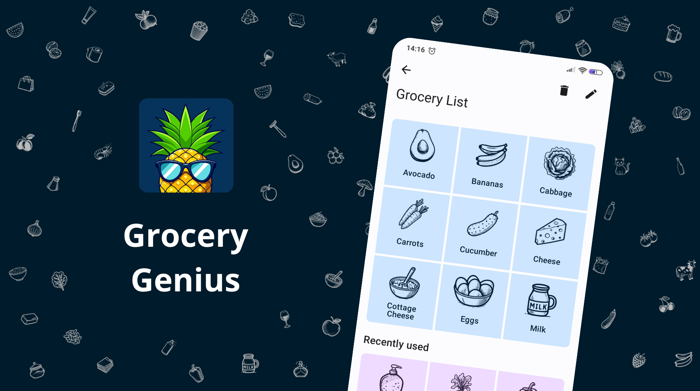
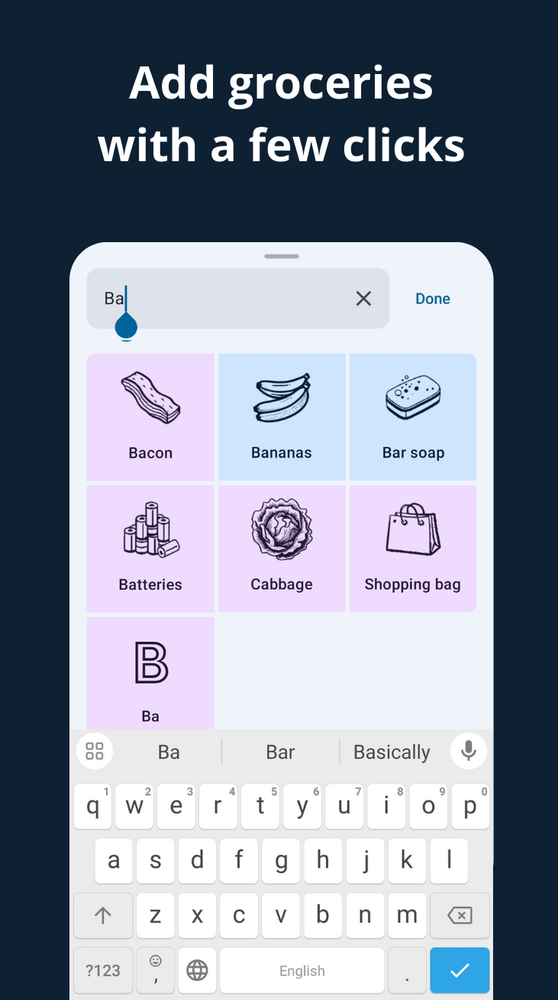
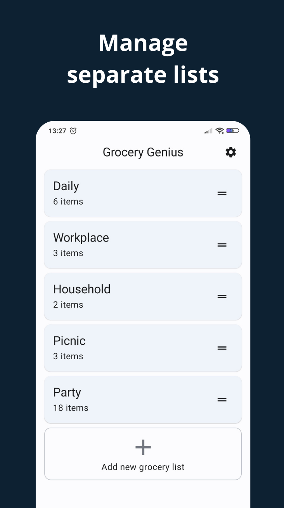
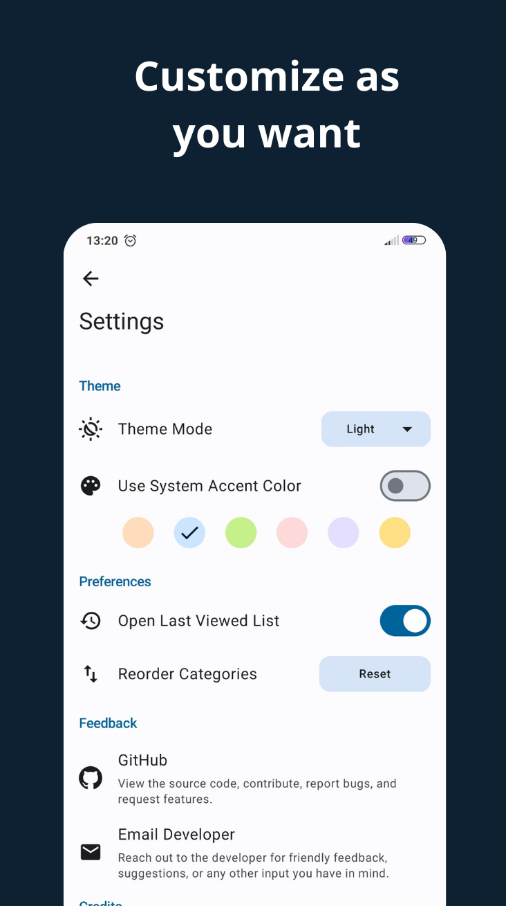

<h1 align="center" style="font-size:28px; line-height:1"><b>Grocery Genius</b></h1>

  

 

 
 

|                                                 |                                               |                                              |
|-------------------------------------------------|-----------------------------------------------|----------------------------------------------|
|  |  |  |

Grocery Genius is a free, customizable shopping list app with a modern design, autocomplete suggestions, offline capabilities, and feature-rich functionality.

## Features

- **Add groceries with a few clicks.** The app has a database of over 130 predefined groceries, each with its own icon. Type as few as two letters, and the best matching items will quickly appear.
- **Add, Edit, and Delete Groceries.** If your grocery item isn’t in the database, it will be created automatically. You can then categorize it, assign an icon, remove it from the list, or delete it entirely.
- **Modern Design.** Unlike many shopping list apps that use a list view, Grocery Genius features a grid view with attractive icons and color-coded separation for purchased and unpurchased items. Groceries are sorted by category, mirroring their placement in stores. The app’s design follows Material You practices, offering dynamic color, dark and light modes, and six color schemes to choose from.
- **Manage Separate Lists.** Create multiple grocery lists and easily reorder them on the main screen with drag-and-drop functionality.
- **Customization.** You can choose a default grocery list, reorder categories, switch between dark and light modes, and choose a different color scheme in the settings.
- **Offline Mode.** Initially, the app requires an internet connection to fetch predefined groceries. After that, you can use it fully offline.
- **Completely Free.** Grocery Genius is free and open source, with no limitations. Add as many grocery lists as you want. All features available now will remain free forever.
- **Respects Your Privacy.** Your confidential data always remains on your device.  Neither the developers nor any third parties have access to your information. For more details, see the [Privacy Policy](https://github.com/DanielRendox/GroceryGenius/blob/develop/PRIVACY_POLICY.md).

## Roadmap

These features may or may not be implemented in the long term.
- Sharing grocery lists with other people
- Location reminders
- Adding photos to items
- Adding items using voice

## Get the app

You can install the app from the [GitHub releases](https://github.com/DanielRendox/GroceryGenius/releases) page or build it yourself by [cloning the project](https://docs.github.com/articles/cloning-a-repository) and launching it in the latest version of [Android Studio](https://developer.android.com/studio).

## Tech stack

- Jetpack Compose for the user interface, with a single Activity and no Fragments
- Room database for local data storage
- Retrofit for working with REST API
- Preferences DataStore for storing simple data in key-value form
- Kotlin coroutines and flow for asynchronous requests
- Work Manager for synching data in the background
- Moshi for decoding JSON files into Kotlin objects
- Coil for loading images from files in a performant way
- RecyclerView for lists with drag-and-drop functionality
- MVI pattern
- CLEAN architecture with data and presentation layer

## License

The project is licensed under the GPL, which means that you can freely build on top of it for commercial and non-commercial purposes alike. But should you choose to incorporate its code, you must open-source your project and apply the GPL license to it as well. Check out the [LICENSE](https://github.com/DanielRendox/GroceryGenius/blob/develop/LICENSE) file for more details.

However, it does not apply to grocery icons contained in the top-level `assets/icons` folder, and its duplicates inside `app/src/debug/assets/icons`. They were generated by Bing Image Creator and Recraft AI and are owned by the companies behind these services respectively. No commercial use of these icons is allowed.
